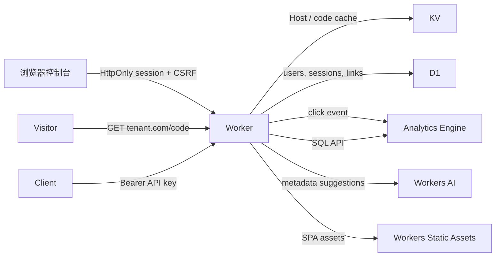

# Links

基于 Cloudflare 生态的多租户短链接服务，包含同源 Web 控制台、账号会话、角色权限和访问分析图表。

- Workers：跳转数据面、控制台 API、静态资源路由与会话校验
- D1：租户、域名、用户、会话、API Key 与短链
- KV：Host 与短码热点缓存
- Analytics Engine：点击维度与分析查询
- Workers AI：链接标题、标签与短码建议
- Static Assets：React 控制台

产品定义见 [docs/PRD.md](docs/PRD.md)，HTTP 契约见 [openapi.yaml](openapi.yaml)。

## 架构



请求路径是非对称的：

- 公开跳转先读 KV，未命中再读 D1，并回填 60 秒缓存。
- 浏览器会话、用户、短链和 API Key 的最终事实来源都在 D1。
- 点击事件 fire-and-forget 写入 Analytics Engine。
- 控制台与 API 同源，不跨域共享 Cookie；API Key 只适合服务端调用。

## 角色与权限

| 权限               | 所有者 | 编辑者 | 只读 |
| ------------------ | ------ | ------ | ---- |
| 查看链接           | ✅     | ✅     | ✅   |
| 创建/编辑/删除链接 | ✅     | ✅     | —    |
| 查看访问分析       | ✅     | ✅     | ✅   |
| 使用 AI 建议       | ✅     | ✅     | —    |
| 管理 API Keys      | ✅     | —      | —    |
| 管理团队成员       | ✅     | —      | —    |

前端按权限隐藏导航和操作按钮，但 API 每次请求都会重新校验角色，前端不作为安全边界。

## 本地开发

要求 Node.js 20+、pnpm 10+。Workers AI 是远端绑定；只调试链接和控制台时也可以使用不依赖 AI 的 `wrangler.ui.jsonc`。

```bash
cp .dev.vars.example .dev.vars
pnpm install
pnpm types
pnpm db:migrate:local
pnpm dev
```

`pnpm dev` 会先构建前端，再启动 Wrangler。设置 `.dev.vars` 中的 `BOOTSTRAP_TOKEN` 后，创建租户和所有者：

```bash
curl http://localhost:8787/api/v1/admin/tenants \
  -H "Authorization: Bearer $BOOTSTRAP_TOKEN" \
  -H "Content-Type: application/json" \
  -d '{
    "name":"Local Studio",
    "slug":"local-studio",
    "hostname":"localhost:8787",
    "owner":{
      "name":"Local Owner",
      "email":"owner@example.com",
      "password":"correct horse battery staple"
    }
  }'
```

打开 <http://localhost:8787/login> 使用所有者邮箱和密码登录。响应中也会返回一次 API Key，用于服务端调用。

如果只验证 UI、链接和权限，不配置 AI，可先执行：

```bash
pnpm build:web
pnpm exec wrangler d1 migrations apply links-ui --local --config wrangler.ui.jsonc
pnpm exec wrangler dev --config wrangler.ui.jsonc --local --port 8789 \
  --var BOOTSTRAP_TOKEN:local-ui-token
```

使用该配置时，把开通请求里的 `hostname` 改为 `localhost:8789`。

## 创建 Cloudflare 资源

```bash
pnpm wrangler login
pnpm wrangler d1 create links-db
pnpm wrangler kv namespace create LINKS_CACHE
```

替换 [wrangler.jsonc](wrangler.jsonc) 中的 D1 `database_id` 和 KV `id`，并填写 32 位账号 ID：

```bash
pnpm wrangler secret put BOOTSTRAP_TOKEN
pnpm wrangler secret put ANALYTICS_API_TOKEN
```

`ANALYTICS_API_TOKEN` 需要 _Account Analytics Read_ 权限。然后应用 migration 并部署：

```bash
pnpm db:migrate:remote
pnpm deploy
```

`pnpm deploy` 会先执行前端构建。静态资源目录为 `dist/`，Worker 通过 `ASSETS` binding 提供 SPA。

| 名称                   | 类型   | 用途                                   |
| ---------------------- | ------ | -------------------------------------- |
| `BOOTSTRAP_TOKEN`      | Secret | 平台开通、用户恢复和 Key 恢复          |
| `ANALYTICS_API_TOKEN`  | Secret | Analytics Engine SQL 只读查询          |
| `ANALYTICS_ACCOUNT_ID` | Var    | Cloudflare 账号 ID                     |
| `ANALYTICS_DATASET`    | Var    | 数据集名称，需与 `wrangler.jsonc` 一致 |
| `AI_MODEL`             | Var    | Workers AI 文本模型                    |
| `PUBLIC_SCHEME`        | Var    | 短链默认协议，localhost 自动使用 HTTP  |

## 自定义域名

控制台、API 和公开短链使用同一个 Host 解析租户。为每个租户域名配置 Workers Custom Domain 或 Route，例如 `links.example.com/*`；子域可使用 `*.links.example.com/*`。短链访问域必须在 `tenant_domains` 中注册。

登录 Cookie 是 host-only：租户 A 的会话不会发送到租户 B 的域名。

## 主要 API

浏览器会话使用 Cookie；服务端集成使用 `Authorization: Bearer <tenant-key>`。会话的写操作还必须发送 `X-CSRF-Token`。

| Method             | Path                                                 | 权限                         |
| ------------------ | ---------------------------------------------------- | ---------------------------- |
| `POST`             | `/api/v1/admin/tenants`                              | 平台 Token                   |
| `GET`              | `/api/v1/admin/tenants`                              | 平台 Token                   |
| `POST`             | `/api/v1/admin/tenants/{id}/api-keys`                | 平台 Token                   |
| `POST`             | `/api/v1/admin/tenants/{id}/users`                   | 平台 Token                   |
| `POST`             | `/api/v1/admin/tenants/{id}/users/{userId}/password` | 平台 Token                   |
| `POST`             | `/api/v1/auth/login`                                 | 公开                         |
| `GET`              | `/api/v1/auth/session`                               | 会话                         |
| `POST`             | `/api/v1/auth/logout`                                | 会话 + CSRF                  |
| `POST`             | `/api/v1/auth/password`                              | 会话 + CSRF                  |
| `GET`              | `/api/v1/me`                                         | 租户身份                     |
| `GET/POST`         | `/api/v1/links`                                      | `links:read` / `links:write` |
| `GET/PATCH/DELETE` | `/api/v1/links/{id}`                                 | `links:read` / `links:write` |
| `GET/POST`         | `/api/v1/users`                                      | `users:manage`               |
| `PATCH`            | `/api/v1/users/{id}`                                 | `users:manage`               |
| `POST`             | `/api/v1/users/{id}/password`                        | `users:manage`               |
| `GET/POST`         | `/api/v1/api-keys`                                   | `api_keys:manage`            |
| `DELETE`           | `/api/v1/api-keys/{id}`                              | `api_keys:manage`            |
| `GET`              | `/api/v1/analytics`                                  | `analytics:read`             |
| `POST`             | `/api/v1/ai/suggest`                                 | `ai:suggest`                 |
| `GET`              | `/{code}`                                            | 公开跳转                     |

## 会话与安全

- 密码使用 PBKDF2-SHA256（100,000 次迭代，Workers 运行时上限、随机 16 字节盐）保存。
- 连续 5 次密码错误锁定 15 分钟；成功登录重置失败计数。
- 会话有效期 7 天，Token 只以 SHA-256 哈希保存在 D1。
- Cookie 使用 `HttpOnly`、`SameSite=Lax`，HTTPS 下自动带 `Secure`。
- 会话写操作校验 CSRF；登录校验同源 Origin。
- 密码修改、成员停用和所有者重置密码会撤销相关会话。
- Cron 每天清理过期会话。
- API Key 使用 24 字节随机秘密，仅保存哈希与可检索前缀。
- 点击分析不保存 IP，不保存完整 Referer，只保存来源域名与 UTM 活动字段。
- 建议为 `/api/v1/auth/login` 和 `/api/v1/admin/*` 配置 WAF 速率限制；账户锁定只覆盖已存在的用户。

## 分析维度

`GET /api/v1/analytics` 返回：

- 总点击量与时间序列
- 热门短链
- 国家/地区
- 来源域名
- 设备类型
- 浏览器
- UTM source / medium / campaign
- 采样权重还原信息

数据保留 90 天，查询范围限制为 90 天。控制台提供趋势图、设备环图、来源条形图和链接排名。

## 验证

```bash
pnpm check
```

该命令会重新生成绑定类型、检查 Worker 与 Web TypeScript、运行 Workers runtime 测试、构建前端，并执行 Wrangler 部署 dry-run。

当前自动化边界：不调用真实 Workers AI、远端 Analytics Engine 或邮件服务；AI 降级、权限、会话、SQL 构造与图表数据契约由 Workers runtime 测试覆盖。开发验收另使用 headless Playwright 检查登录、RBAC、短链创建、分析图表和移动导航，但这些浏览器验收暂未进入 `pnpm check`。真实模型质量、账号级分析和线上 Cookie/Custom Domain 行为仍需部署后验收。
